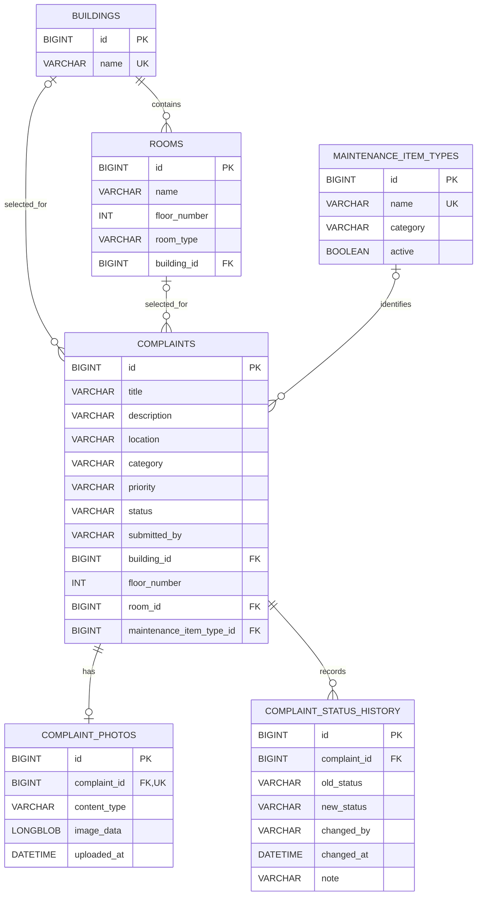

# University Maintenance Management System

## Project Overview

The University Maintenance Management System is a Spring Boot web application developed for the Faculty of Engineering, University of Ruhuna.

It provides a central platform for reporting, tracking and managing maintenance complaints involving university buildings, classrooms, laboratories, study areas and other facilities.

Students, lecturers and non-academic staff can submit complaints and monitor their progress. Maintenance administrators can manage complaints, record progress updates and receive Gemini AI recommendations.

This application was developed as an academic web application development project.

## Technologies Used

- Java 17
- Spring Boot 4
- Spring MVC
- Thymeleaf
- Spring Data JPA / Hibernate
- Spring Security
- MySQL
- HTML, CSS and JavaScript
- Gemini API
- Maven
- Git and GitHub
- Docker
- Render for web hosting
- External MySQL database hosting

## Main Features

### Complaint Submission

Authorised users can:

- Submit maintenance complaints.
- Enter a title and detailed description.
- Select a building, floor and room or facility area.
- Identify the maintenance category.
- Select the affected equipment or facility item.
- Select a reported priority.
- Attach one optional JPG or PNG photograph up to 5 MB.
- View their own submitted complaints.

### User Roles

The application supports four demonstration account types:

| Role | Responsibilities |
|---|---|
| Student | Submit, track and edit own pending complaints |
| Lecturer | Submit, track and edit own pending complaints |
| Non-Academic Staff | Submit, track and edit own pending complaints |
| Administrator | Review and manage all complaints |

Personal complaint editing is restricted to the complaint owner while the complaint has PENDING status.

Administrators have access to the complaint management functions.

### Maintenance Administration

Administrators can:

- View all complaints.
- Search, filter and sort complaint records.
- Edit complaint information.
- Change complaint status.
- Record progress or resolution notes.
- View uploaded photographs.
- Delete complaints.
- Review the recorded status history.
- Request AI recommendations.

### Complaint Status Tracking

The application uses three main statuses:

1. PENDING
2. IN_PROGRESS
3. COMPLETED

Status changes are stored in a separate history table.

Each history record contains:

- Previous status
- New status
- Username of the person making the update
- Date and time
- Optional maintenance note

Newly submitted complaints also receive an initial status history record.

### Gemini AI Integration

The system provides two AI features.

**Individual Complaint Analysis**

Gemini analyses an individual complaint and suggests a maintenance category, priority, appropriate team and explanation.

**Collective Maintenance Prioritisation**

The administrator can analyse the current pending complaints together.

Gemini recommends up to three maintenance tasks based on reported hazards, seriousness, disruption and available submission history.

The administrator reviews these recommendations before taking action.

AI recommendations are advisory. They do not automatically update the database or assign maintenance personnel.

## Database Design

The application uses a relational MySQL database named `university_maintenance`.

It has six main entity tables.

### 1. buildings

Stores university buildings and other faculty facilities.

Important columns:

- id — Primary Key
- name — Unique building name

### 2. rooms

Stores rooms and facility areas within buildings.

Important columns:

- id — Primary Key
- name
- floor_number
- room_type
- building_id — Foreign Key

A building can contain multiple rooms.

A unique constraint prevents duplicate room names on the same floor within one building.

### 3. maintenance_item_types

Stores the catalogue of equipment and facility items that may require maintenance.

Important columns:

- id — Primary Key
- name — Unique
- category
- active

Examples include fans, lights, projectors, computers, water taps, furniture and air-conditioning equipment.

### 4. complaints

Stores the submitted maintenance requests.

Important columns:

- id — Primary Key
- title
- description
- location
- category
- priority
- status
- submitted_by
- building_id — Foreign Key, optional
- floor_number — Optional
- room_id — Foreign Key, optional
- maintenance_item_type_id — Foreign Key, optional

### 5. complaint_photos

Stores the optional photograph associated with a complaint.

Important columns:

- id — Primary Key
- complaint_id — Unique Foreign Key
- content_type
- image_data — LONGBLOB
- uploaded_at

A complaint can have zero or one stored photograph.

### 6. complaint_status_history

Stores the recorded maintenance status updates.

Important columns:

- id — Primary Key
- complaint_id — Foreign Key
- old_status
- new_status
- changed_by
- changed_at
- note

A complaint can have multiple history records.

## Entity Relationship Diagram



The application uses primary keys, foreign keys, unique constraints, appropriate data types and relationships to organise the maintenance information.

## Project Structure

```text
src/
  main/
    java/com/unimaintenance/maintenance/
      config/
      controller/
      entity/
      exception/
      repository/
      service/
      UniversityMaintenanceApplication.java
    resources/
      static/
        css/
        images/
      templates/
        complaints/
      application.properties
  test/
    java/com/unimaintenance/maintenance/
```

## Running Locally

### Requirements

- Java 17
- MySQL Server
- Maven Wrapper (included)
- VS Code or another Java IDE
- Internet access for Gemini features

### Database Setup

Create a MySQL database:

```sql
CREATE DATABASE IF NOT EXISTS university_maintenance;
```

The application uses Spring Data JPA and Hibernate to create or update tables during development.

The local database connection defaults to:

`jdbc:mysql://localhost:3306/university_maintenance`

### Environment Variables

| Variable | Purpose |
|---|---|
| DB_URL | JDBC database URL |
| DB_USERNAME | Database username |
| DB_PASSWORD | Database password |
| GEMINI_API_KEY | Gemini API key |
| DEMO_STUDENT_PASSWORD | Student demo password |
| DEMO_ADMIN_PASSWORD | Administrator demo password |
| DEMO_LECTURER_PASSWORD | Lecturer demo password |
| DEMO_STAFF_PASSWORD | Staff demo password |
| PORT | Application port, defaults to 8080 |
| SEED_FACULTY_DATA | Enables faculty building and room initialisation |
| SEED_MAINTENANCE_TYPES | Enables maintenance item catalogue initialisation |

Student and administrator passwords are required.

Lecturer and staff accounts are created when their corresponding passwords are configured.

Do not commit passwords, API keys, private certificates or database credentials.

### Start the Application

On Windows:

```powershell
.\mvnw.cmd spring-boot:run
```

Then open:

`http://localhost:8080`

### Demo Accounts

| Username | Role |
|---|---|
| student1 | Student |
| lecturer1 | Lecturer |
| staff1 | Non-Academic Staff |
| admin | Administrator |

Passwords are supplied through environment variables, not stored in source code.

## Faculty Data Initialisation

The project contains two optional database initialisers.

`FacultyDataInitializer` adds faculty building and room records.

`MaintenanceItemTypeInitializer` adds the maintenance item catalogue.

The initialisers are disabled by default.

To enable them temporarily in a PowerShell session:

```powershell
$env:SEED_FACULTY_DATA="true"
$env:SEED_MAINTENANCE_TYPES="true"
.\mvnw.cmd spring-boot:run
```

After the initialisation succeeds, stop the application and disable both flags:

```powershell
$env:SEED_FACULTY_DATA="false"
$env:SEED_MAINTENANCE_TYPES="false"
```

The initialisers check for existing entries to avoid inserting the same catalogue records repeatedly.

These commands do not delete existing records.

## Cloud Deployment

The application supports deployment using its root Dockerfile.

The web application can run on Render with an external MySQL database.

Required hosting configuration includes:

- Docker deployment
- A reachable MySQL database
- Database connection environment variables
- Demo account passwords
- Gemini API key for AI analysis
- Server port configuration

For Render, the application can use `PORT=10000`.

When deploying to a fresh database, the schema must be created and the faculty and maintenance item catalogue data must be populated.

Keep secrets in hosting environment variables rather than GitHub.

Before deploying database changes, back up existing data.

## Testing

Local verification should cover:

- Successful login for all supported roles
- Restricted access to administrator routes
- Complaint creation, updating and deletion
- Ownership checks on personal complaint editing
- Building, floor and room selection
- Affected maintenance item selection
- JPG and PNG photograph uploads
- Photograph replacement
- Complaint status history
- Individual Gemini analysis
- Collective Gemini priority recommendations
- Mobile browser responsiveness

Run the automated unit tests with:

```powershell
.\mvnw.cmd test
```

Database-backed workflows must also be tested manually or with separate integration tests.

## Screenshots and Demonstration

The final demonstration should include:

- Home and login pages
- Complaint submission
- Personal complaint tracking
- Administrator complaint dashboard
- Complaint edit and status history
- Photograph upload and display
- Gemini AI prioritisation
- Mobile responsive layout

Screenshots and the final demonstration video will be added as part of the project submission.

## Limitations

- Accounts are configured in memory for demonstration purposes.
- Public user registration and password recovery are not implemented.
- The application is not connected to the university's official authentication service.
- Gemini requires a configured API key and network access.
- AI recommendations may be incorrect and require administrator review.
- Complaint photographs consume MySQL database storage.
- Maintenance staff assignments are handled outside this application.

## Project Purpose

This project demonstrates Spring MVC, database relationships, CRUD operations, role-based access control, validation, REST API integration, responsive interfaces and deployment of a web application.
